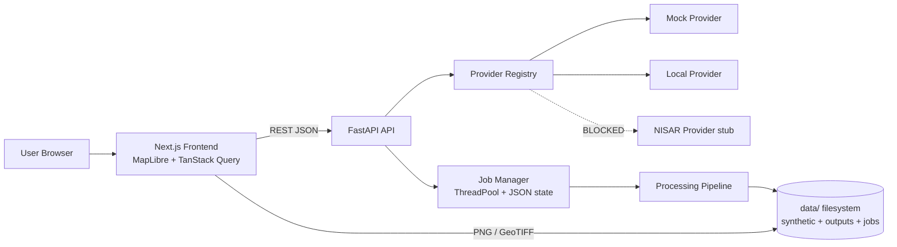
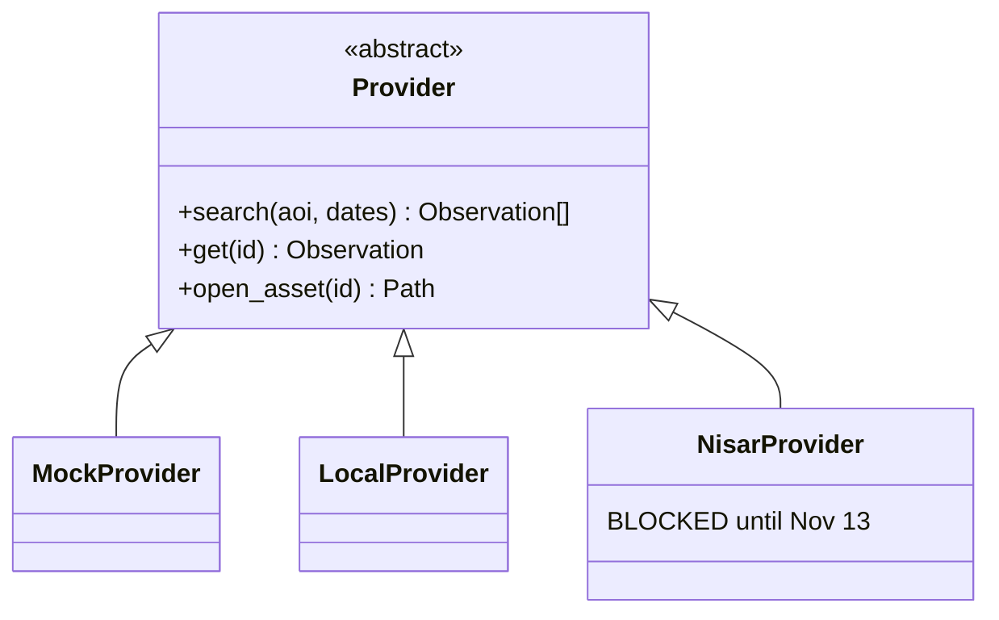
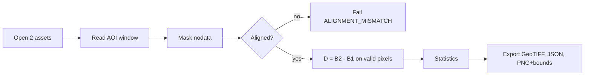
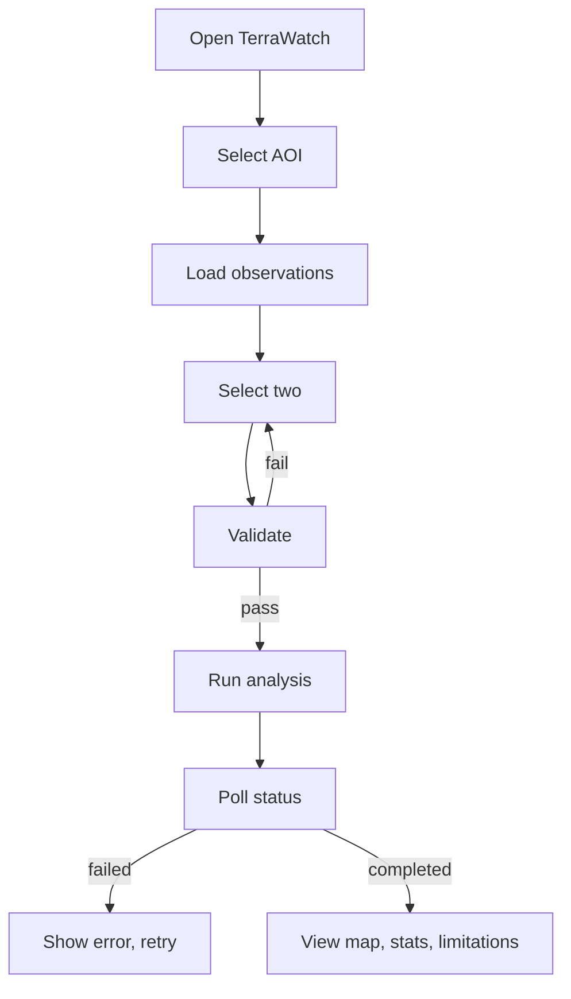
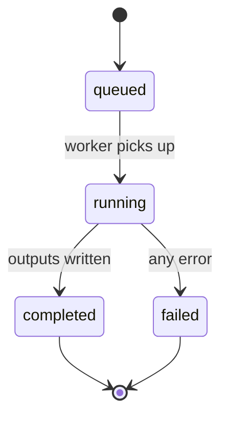

# TerraWatch AI — Antigravity Master Prompt & PRD

*Phase A (pre-hackathon foundation) · NASA Space Apps 2026 · "Dancing with the SARs" · Official resources release: Fri 13 Nov 2026*

## 0. How to use this document

1. Create an empty repo `terrawatch-ai`. Open it in Antigravity.
2. Save Sections 1–10 as `PRD.md` and Section 1 + Section 2 also as `AGENTS.md` (and, if your Antigravity version supports workspace rules, copy Section 1 into `.agent/rules/`). Agents then re-read the rules on every task.
3. Paste the **Kickoff Prompt (Section 11)** into the Agent Manager.
4. Work milestone by milestone. Do not let an agent start a milestone until the previous gate passes.

**Scope of this document:** Phase A only. Anything that needs real NISAR documentation is marked BLOCKED and must not be guessed.

---

## 1. Agent Operating Contract (mandatory)

**Role.** You are a combined Product Manager, Software Architect, Full-Stack Engineer, Geospatial/SAR Engineer, UX Designer and QA Engineer on a strict hackathon deadline.

**Priorities (in order):** correctness → complete end-to-end workflow → scientific honesty → maintainability → visuals.

**Hard rules**

- R1. Build only what Section 4 lists. If a feature is not traceable to the core workflow, do not build it.
- R2. Never invent NISAR endpoints, URLs, HDF5 paths, product names, polarizations, auth flows, calibration steps or coverage. `nisar_provider.py` is a documented stub that raises `NotImplementedError("BLOCKED: awaiting official NISAR resources")` and is never registered as an active provider.
- R3. Synthetic data is always labelled **"DEMO DATA — SYNTHETIC, NOT REAL NISAR OBSERVATIONS"** in the API (`synthetic: true`), the UI (persistent banner + result badge) and every exported metadata file.
- R4. No fake data in the UI: no fabricated metrics, no fake progress percentages, no hardcoded success responses, no dead buttons, no "Coming soon".
- R5. Never hardcode a flood threshold or label changed pixels as flood. Output is a **dB difference**, nothing more.
- R6. No auth, accounts, billing, chatbot, LLM calls, admin pages, extra map providers, extra databases, microservices.
- R7. Status vocabulary in all reports: **VERIFIED** (proved by a command you ran and its output), **PARTIAL**, **PLANNED**, **BLOCKED**, **RECOMMENDED**. Never write "done" without a passing command to show.
- R8. Inspect the repo before changing it. If code exists, reuse what works; do not rewrite without a stated reason.
- R9. Pin dependency versions at install time (use the latest stable at that moment, record in lockfiles). Do not add a package unless a concrete requirement needs it.
- R10. Any ambiguity not resolved by this document: choose the simplest option, record it in `docs/decisions.md` (one line: decision, reason), and continue. Do not stop to ask unless the choice would violate R1–R6.

**Verification gate (every milestone).** Before declaring a milestone finished: run its listed commands, paste real output summaries into `docs/progress.md`, and list any PARTIAL/PLANNED items honestly.

---

## 2. Speed Accelerators (decisions already made — do not re-debate)

| Area | Decision | Why it saves time |
| --- | --- | --- |
| Repo | Monorepo, root `Makefile` with `make setup`, `make dev`, `make test`, `make fixtures`, `make build` | One command per task, agents and humans use the same entry points |
| Persistence | **No database.** JSON files under `data/` (`data/jobs/<id>.json`, `data/outputs/<job_id>/…`). Observation catalog is read from provider at request time | Zero infra, trivially deployable; satisfies "choose one strategy" |
| Jobs | In-process `ThreadPoolExecutor` (max 2 workers) + job state written atomically to JSON after every stage change. No Celery/Redis | Real state, minimal code |
| Job progress | `stage` field: `queued → validating → reading → aligning → differencing → statistics → exporting → completed/failed`. **No percentages** | Honest and simple |
| Contracts | Pydantic models are the source of truth → FastAPI auto-generates OpenAPI → `openapi-typescript` generates `frontend/lib/api-types.ts` via `make types` | Frontend/backend cannot drift; parallel agents share one contract |
| Map rendering of results | Backend renders a colorized **PNG + WGS84 bounds**; frontend adds it as a MapLibre `image` source. **No tile server, no COG tiling** | Biggest complexity cut; sufficient for small rasters |
| Drawing AOI | `terra-draw` with its MapLibre adapter (polygon + rectangle modes), fall back to a preset "Use demo area" button | Maintained lib, avoids hand-rolled drawing |
| Basemap | One keyless basemap style (e.g. OpenStreetMap raster tiles) configured in one constant | No API keys |
| UI kit | shadcn/ui components only: Button, Card, Badge, Table, Alert, Tabs, Skeleton, Sonner toast | Consistent, fast |
| Data fetching | TanStack Query with one typed `apiClient` in `frontend/lib/api.ts` | Uniform loading/error/empty handling |
| Cross-page state | URL search params (`?before=…&after=…&job=…`) + AOI in `sessionStorage` wrapped in try/catch | Pages are linkable, no global store library |
| Fixtures | `make fixtures` runs `backend/scripts/make_synthetic.py` (deterministic, seeded, idempotent) | Tests and demo share identical data |
| Testing | Backend: `pytest` + FastAPI `TestClient`. Frontend: Vitest + React Testing Library. E2E: Playwright (one spec) | Covers Section 9 with minimum tooling |
| Python | 3.11+, `ruff` for lint/format, `pytest`. TypeScript `strict: true`, ESLint | Fast feedback |
| Deployment | Frontend → Vercel. Backend → one Docker container (rasterio wheels bundle GDAL; if install fails, use the official `python:3.11-slim` image with `pip install rasterio`). Synthetic outputs are regenerated on container start | Avoids hosted DB/object storage |
| CORS | Allowed origins from `CORS_ORIGINS` env var (comma-separated) | One config knob |

**Parallel agent lanes (Antigravity Agent Manager).** After Milestone 1 and after the contract (Section 6) is committed, run three agents in parallel, each owning a directory and never editing another lane's files:

- **Lane A — Backend/Processing:** `backend/app/processing/**`, `backend/scripts/**`, `backend/tests/processing/**`
- **Lane B — Backend API/Providers:** `backend/app/api/**`, `providers/**`, `services/**`, `schemas/**`, `backend/tests/api/**`
- **Lane C — Frontend:** `frontend/**`, developed against `openapi.json` and MSW/fixture responses until Lane B lands

Merge only when each lane's tests pass.

---

## 3. Product Overview

**TerraWatch AI** — *"Making Earth's changing surface easier to observe, understand, and communicate."*

A web app where a user selects a study area, lists observations from a configured provider, picks two, validates that they are comparable, runs a comparison, and views a georeferenced dB-difference map with statistics and stated limitations.

**Challenge alignment.** The challenge asks for an interactive application that uses NISAR radar data to track and visualize surface change (flood, wetlands, forest, agriculture, soil moisture, ice, deformation). Phase A delivers the provider-agnostic pipeline and UI; Phase B (after 13 Nov) connects real NISAR products.

**Problem.** Radar change data is hard to interpret and hard to access; non-experts need a guided, honest view from selection to map.

**Objectives.** (1) Complete synthetic end-to-end workflow, deployed. (2) Provider boundary ready for NISAR. (3) Tested processing core. (4) Zero misleading content.

**Users.** Hackathon team (builders), judges (evaluate in under 3 minutes), and later analysts/students exploring surface change.

**Core workflow**

`Explore (AOI) → Observations (search, pick 2) → Analysis (validate, run, status) → Results (map, stats, limitations)`

---

## 4. Scope

**In scope:** five pages (Dashboard, Explore, Observations, Analysis, Results); eight API endpoints; mock + local providers; NISAR stub; processing pipeline (read, validate, align, difference, stats, export); synthetic dataset; tests; deployment; docs.

**Out of scope (Phase A):** real NISAR download/reader/HDF5 paths/calibration; flood classification; final study area; AI/chatbot/AI explanations; accounts, billing, admin, notifications, sharing; time-series animation; multi-satellite; PDF/report export; additional analysis modes; additional endpoints.

---

## 5. Functional Requirements

All are **Status: PLANNED** unless noted. Actor: User (U) or System (S). Each requirement has failure behavior and a testable criterion in the same row.

| ID | P | Actor | Requirement | Failure behavior | Acceptance test |
| --- | --- | --- | --- | --- | --- |
| FR-01 | P0 | U | Dashboard shows title, description, "Start analysis" (→ /explore), demo-mode banner, study-area summary (or empty state), recent analyses read from `data/jobs` | If jobs API fails: inline error + retry; empty list shows empty state | Render test: empty and populated states; button navigates |
| FR-02 | P0 | U | Explore map initializes with MapLibre, pan/zoom, draw polygon/rectangle, "Use demo area" button, "Clear" button | Map style load failure shows Alert with retry; invalid geometry shows validation message and is not stored | Draw/clear test; invalid polygon (self-intersecting) rejected |
| FR-03 | P0 | S | AOI validated client-side (closed ring, ≥3 distinct vertices, lon/lat in range) and server-side (Shapely `is_valid`, area ≤ configured max, ≤ 500 vertices) | HTTP 422 `INVALID_GEOMETRY` with reason | API tests for each rule |
| FR-04 | P0 | U | Display AOI bbox, centroid, approximate area (computed with PyProj geodesic or equal-area projection) | Hidden when no AOI | Value matches known test polygon within tolerance |
| FR-05 | P0 | U | Observations page lists provider results intersecting AOI: id, date, provider, polarization, band, orbit direction, units, synthetic badge; missing fields show "Not provided" | Empty result → empty state; provider error → Alert | Table test with missing metadata |
| FR-06 | P0 | U | Select exactly two observations; chronological order is assigned automatically (earlier = before) | Third selection replaces nothing; shows hint; same ID twice blocked | Selection test |
| FR-07 | P0 | S | `POST /api/analysis/validate` runs rules in Section 8.3 and returns per-rule results | Unknown ID → 404 `OBSERVATION_NOT_FOUND` | Pair tests: compatible, each failure rule |
| FR-08 | P0 | U | "Run analysis" is disabled until AOI set, two observations chosen and validation passed | Server re-validates; rejects with 422 `INCOMPATIBLE_OBSERVATIONS` | UI disabled-state test + API rejection test |
| FR-09 | P0 | S | `POST /api/analysis` creates a job (state `queued`) and returns `job_id` immediately | Validation failure → no job created | Job file exists after call |
| FR-10 | P0 | U | Analysis page polls job status (2 s interval, stops on terminal state) and shows state + current stage | Network failure shows retry; `failed` shows `error.code/message` | Test with mocked transitions and real backend |
| FR-11 | P0 | S | Processing executes the pipeline in Section 8 and writes outputs only on success | Any exception → job `failed` with error code; partial outputs removed | Corrupt-raster test produces `failed` |
| FR-12 | P0 | U | Results page shows difference layer on map, Before/After/Difference toggle, legend (dB, symmetric diverging scale, range from output), statistics, source observation IDs, processing metadata, limitations, synthetic badge | Missing output → "Results not available" state, never a blank map | Test with completed, running, failed and missing job |
| FR-13 | P0 | S | `GET /api/analysis/{id}/results` returns results only if state is `completed` and files exist | 409 `JOB_NOT_COMPLETED` or 404 `RESULT_NOT_FOUND` | Status-code tests |
| FR-14 | P0 | S | Export: georeferenced GeoTIFF difference, `statistics.json`, `metadata.json`, PNG overlay + bounds | Export failure → job `failed` | Rasterio re-read of output matches array |
| FR-15 | P0 | S | Provider configured by `PROVIDER` env (`mock` \| `local`); `nisar` raises a clear BLOCKED error | Unknown value → app refuses to start with message | Config tests |
| FR-16 | P0 | S | `GET /api/health` returns real status: version, active provider, data dir writable, fixtures present | Returns 503 with failing checks | Test with missing dir |
| FR-17 | P1 | S | Local provider reads a directory of rasters + sidecar `*.json` metadata; paths validated against allowed root (no traversal) | Missing/invalid sidecar → observation skipped and listed under `warnings` in search response | Traversal test; missing-sidecar test |
| FR-18 | P1 | U | Deterministic, template-based result summary built only from `statistics.json` and metadata (e.g. "Mean difference −0.69 dB over 4064 valid pixels") | Omitted if stats missing | Snapshot test |
| FR-19 | P1 | U | Responsive layout: desktop and tablet full workflow; mobile has usable nav and results view | — | Playwright at 1280, 820, 390 widths |
| FR-20 | P1 | S | Optional GeoJSON summary of changed-area bounding polygons — **RECOMMENDED**, build only if Milestones 1–6 are green | — | — |
| FR-21 | P0 | S | Real NISAR provider/reader | BLOCKED stub only | Test asserts stub raises BLOCKED |

---

## 6. API Contracts (source of truth = Pydantic models; this is the intent)

**Error envelope (all non-2xx):** `{ "error": { "code": "STRING", "message": "human readable", "details": {} } }`

Codes: `INVALID_GEOMETRY`, `OBSERVATION_NOT_FOUND`, `INCOMPATIBLE_OBSERVATIONS`, `JOB_NOT_FOUND`, `JOB_NOT_COMPLETED`, `RESULT_NOT_FOUND`, `PROVIDER_ERROR`, `PROVIDER_NOT_AVAILABLE`, `INTERNAL_ERROR`.

| Endpoint | Request | Success response | Errors |
| --- | --- | --- | --- |
| `GET /api/health` | — | `{status, version, provider, synthetic_mode, checks:{data_dir, fixtures}}` | 503 |
| `POST /api/observations/search` | `{aoi: GeoJSON Polygon, start_date?, end_date?}` | `{observations: Observation[], warnings: string[]}` | 422, 502 |
| `GET /api/observations` | query: `limit` (default 50, max 200), `offset` | `{observations, total}` | 502 |
| `GET /api/observations/{id}` | — | `Observation` | 404 |
| `POST /api/analysis/validate` | `{before_id, after_id, aoi}` | `{compatible: bool, rules: [{id, severity: error\|warning, passed, message}], order: {before_id, after_id}}` | 404, 422 |
| `POST /api/analysis` | same as validate | `{job_id, status:"queued"}` (HTTP 202) | 404, 422 |
| `GET /api/analysis/{job_id}` | — | `{job_id, status, stage, created_at, started_at?, finished_at?, before_id, after_id, synthetic, error?}` | 404 |
| `GET /api/analysis/{job_id}/results` | — | `{statistics, bounds:[w,s,e,n], layers:{difference_png, before_png, after_png}, geotiff_url, metadata, limitations[], synthetic}` | 404, 409 |

Static file serving: result PNG/GeoTIFF files are served from `/files/outputs/{job_id}/…` through a path-validated static route (not a ninth API endpoint).

**Observation model (required fields minimal; the rest optional):**

`id`, `provider`, `synthetic` (bool), `acquisition_date` (ISO 8601), `geometry` (GeoJSON footprint), `asset_location`, `asset_format`; optional: `product_name`, `polarization`, `frequency_band`, `orbit_direction`, `processing_level`, `measurement_units`, `resolution`, `crs`, `source_metadata` (raw dict preserved untouched).

**Job file (`data/jobs/<id>.json`):** `job_id, status, stage, created_at, started_at, finished_at, before_id, after_id, aoi, synthetic, error{code,message}, result_dir`. Written atomically (write temp, then `os.replace`).

---

## 7. Provider Architecture

```text
backend/app/providers/
  base.py            # abstract Provider: search(aoi, dates) / get(id) / open_asset(id) -> local path
  mock_provider.py   # reads data/synthetic catalog; every record synthetic=true
  local_provider.py  # scans LOCAL_DATA_DIR for raster + sidecar json
  nisar_provider.py  # BLOCKED stub, docs only
  registry.py        # get_provider() from PROVIDER env; single place of selection
```

Rules: frontend never imports provider specifics; the processing engine receives only a local file path and a normalized `Observation`; `nisar_provider.py` docstring points to `docs/nisar-integration-checklist.md`.

---

## 8. Scientific Processing Specification

### 8.1 Module contracts

```text
backend/app/processing/
  readers/base.py        # Reader.read(path, window?) -> RasterData
  readers/geotiff.py     # Rasterio reader (synthetic/local only)
  metadata.py            # sidecar parsing -> normalized fields
  validation.py          # compatibility rules -> RuleResult[]
  preprocessing.py       # nodata -> NaN mask; AOI window crop
  alignment.py           # check_alignment(a,b) / align(b_to_a)
  change_detection.py    # difference_db(before, after) -> DifferenceResult
  statistics.py          # compute_stats(diff) -> Stats
  export.py              # GeoTIFF, JSON, PNG + bounds
  pipeline.py            # orchestrates stages; updates job stage
```

`RasterData`: `array` (float32, 2D), `transform`, `crs`, `nodata`, `units`, `bounds`, `resolution`. Each function is pure (no I/O except readers/export) and has unit tests.

### 8.2 Method

1. Read both rasters within the AOI window (reject if window empty).
2. Convert nodata to a validity mask. Never use `-9999` in arithmetic.
3. Alignment: if CRS, transform, resolution, extent and shape are identical → proceed. If they differ and `align()` is not applicable → fail with `ALIGNMENT_MISMATCH`. **Never silently compare arrays that differ.** (Resampling is implemented only for the tested case of same CRS + same resolution + shifted extent → crop to intersection; anything else is rejected.)
4. `D = B2 − B1` only where both pixels valid; units preserved (dB). Output nodata = NaN in memory, `-9999` in GeoTIFF with nodata tag.
5. Stats on valid pixels only: `valid_pixel_count`, `total_pixel_count`, `mean`, `median`, `min`, `max`, `std`, plus `invalid_pixel_count`. No areas unless computed with a geodesic/equal-area method.
6. Export GeoTIFF (LZW, same CRS/transform), `statistics.json`, `metadata.json`, three PNG overlays + bounds in EPSG:4326.
7. PNG colorization: difference uses a diverging colormap symmetric around 0 with `±max(|p2|,|p98|)` recorded in metadata (legend reads it from there); nodata fully transparent. Before/after use a single-hue ramp with their own recorded min/max.

### 8.3 Compatibility rules

| Rule ID | Check | Severity |
| --- | --- | --- |
| V-SAME-ID | before ≠ after | error |
| V-ORDER | dates differ; earlier assigned as "before" | error if equal dates |
| V-UNITS | both `measurement_units` present and equal (dB required for difference) | error |
| V-POL | polarization equal when both present; if either missing → warning | error / warning |
| V-BAND | frequency band equal when both present | error |
| V-ORBIT | orbit direction equal when both present; missing → warning | error / warning |
| V-LEVEL | processing level equal when both present | error |
| V-CRS | CRS equal | error |
| V-GRID | resolution equal within tolerance | error |
| V-AOI | both footprints intersect the AOI and the intersection of data window is non-empty | error |
| V-VALID | ≥ 1 % valid pixels remain in the AOI window | error |

Never treat identical dimensions alone as compatibility. Rules that depend on real NISAR product semantics are refined in Phase B.

### 8.4 Limitations text (shown on Results, stored in output metadata)

- Difference of calibrated SAR backscatter (dB) between two dates; it is **not** a classified event map.
- Changes may come from surface change, soil moisture, vegetation, wind, incidence angle, speckle, or processing differences.
- No threshold or classification has been applied.
- Synthetic runs: *"DEMO DATA — SYNTHETIC, NOT REAL NISAR OBSERVATIONS. No real-world conclusion can be drawn."*

---

## 9. Synthetic Data Specification (deterministic, exact expected values)

Generated by `make fixtures` into `data/synthetic/`. All rasters: 64×64, float32, EPSG:4326, pixel size 0.001°, nodata `-9999`, origin top-left at (lon 73.800, lat 18.560) (generic placeholder area; no real-world claim).

| File | Content | Sidecar metadata |
| --- | --- | --- |
| `syn_before.tif` | all pixels −15.0 dB, except nodata block rows 0–3, cols 0–3 | dB, HH, L-band label "synthetic", date 2026-01-01, `synthetic:true`, `provider:"synthetic_demo"` |
| `syn_after.tif` | −15.0 dB, except block rows 20–39, cols 20–39 = −22.0 dB, and nodata block rows 60–63, cols 60–63 | same, date 2026-01-13 |
| `syn_misaligned.tif` | 64×64 but pixel size 0.002° | same metadata, date 2026-01-25 (tests V-GRID) |
| `syn_wrongunits.tif` | same grid as before | `measurement_units:"linear"`, date 2026-02-06 (tests V-UNITS) |
| `aoi.geojson` | polygon covering the full raster extent | — |
| `expected_stats.json` | values below | — |

**Expected stats for before→after (to be asserted in tests):** `total=4096`, `invalid=32`, `valid_pixel_count=4064`, changed pixels = 400 with D = −7.0, unchanged valid = 3664 with D = 0.0, `mean = −2800/4064 ≈ −0.68898`, `median = 0.0`, `min = −7.0`, `max = 0.0`, `std` computed analytically in the test from these counts.

Polarization/band/orbit labels are fixture-only values. They must not be reused as assumptions about NISAR products.

---

## 10. Frontend, UX, Security, Testing, Deployment

**Design.** Dark, restrained, map-first. Pages: `/dashboard`, `/explore`, `/observations`, `/analysis`, `/results`; top nav limited to those five. Persistent amber banner whenever `synthetic` is true. Accessible contrast (WCAG AA), visible focus, keyboard-operable controls.

**Every async view implements:** initial, loading (Skeleton), success, empty, validation error, server error, network failure. Every button: real action, loading state, disabled state when invalid, error handling. Toasts only for real events.

**Frontend structure**

```text
frontend/
  app/{dashboard,explore,observations,analysis,results}/page.tsx
  components/{map,observations,analysis,results,ui}/
  lib/{api.ts, api-types.ts (generated), geo.ts (AOI validation), config.ts}
  e2e/workflow.spec.ts
```

**Security.** Secrets only in env; `.env` git-ignored; `.env.example` committed (`PROVIDER`, `CORS_ORIGINS`, `DATA_DIR`, `LOCAL_DATA_DIR`, `MAX_AOI_AREA_KM2`, `NEXT_PUBLIC_API_BASE_URL`). GeoJSON validation; path-traversal guard on provider and static file routes; request body size limit; no secrets in frontend bundle; CORS restricted to configured origins.

**Testing (must run in CI-style via `make test`)**

- Backend: health; mock + local providers; normalization and missing metadata; invalid AOI; each compatibility rule; reader; alignment mismatch; difference math; nodata handling; stats equal `expected_stats.json`; export re-read; failed job with corrupt raster; results endpoint status codes; path traversal.
- Frontend (Vitest/RTL): dashboard states; AOI validation; observation table with missing fields; two-selection logic; disabled run button; job status rendering for all four states; results empty/failed states; synthetic banner.
- E2E (Playwright, one spec, backend with `PROVIDER=mock`): open app → "Use demo area" → load observations → select before/after → validate → run → wait for `completed` → map result visible → statistics match expected → synthetic banner visible. No manual DB edits or direct API calls.

**Deployment.** `make build` passes; backend Dockerfile runs `make fixtures` at start; health check at `/api/health`; deployed demo runs the full synthetic workflow; README documents local setup, env vars, deploy steps and known limitations.

---

## 11. Architecture Diagrams

**1. System architecture**



**2. Provider architecture**



**3. Raster-processing pipeline**



**4. User workflow**



**5. Job lifecycle**



---

## 12. Milestones with Gates (commands the agent must run and report)

| # | Milestone | Deliverables | Gate (must pass) |
| --- | --- | --- | --- |
| M1 | Foundation | Monorepo, Makefile, Next.js + FastAPI skeletons, env files, `/api/health`, AGENTS.md, `docs/progress.md`, `docs/decisions.md` | `make setup && make dev` starts both; `curl /api/health` returns 200; frontend shows health status |
| M2 | Contracts + fixtures | Pydantic schemas for all endpoints, `make types`, `make_synthetic.py`, `expected_stats.json` | `make fixtures` twice yields identical files (hash check); `api-types.ts` generated |
| M3 | **Parallel:** Lanes A, B, C | A: processing modules + tests. B: providers, validate/analysis/results endpoints, job manager. C: five pages against fixtures/MSW | `pytest` green for processing; API tests green; frontend `vitest` green |
| M4 | Integration | Frontend wired to real API, status polling, results map with PNG overlay | Manual run of full workflow in browser by the Antigravity browser agent; screenshot saved to `docs/evidence/` |
| M5 | Hardening | Error states everywhere, path guards, failed-job test, responsive checks, accessibility pass | Playwright spec passes at three widths |
| M6 | Deploy | Dockerfile, Vercel config, README, deployed workflow check | Deployed URL completes workflow; `/api/health` OK; no secrets in bundle (grep check) |
| M7 | Resource readiness | `docs/nisar-integration-checklist.md`, `docs/nisar-metadata-mapping.md` (template with empty columns), study-area selection criteria, provider implementation notes | Docs exist; no invented NISAR facts (reviewer greps for URLs and HDF5 paths: must be none) |

**NISAR checklist (M7) must contain questions, not answers:** What product levels and formats are provided? How is data accessed and authenticated? Which polarizations/bands exist? Are values in linear power, amplitude, or dB? What calibration notes apply? How are footprints and CRS expressed? Which study area has two usable acquisitions? What are file sizes and expected processing time? What are the product-specific compatibility rules to add to Section 8.3?

---

## 13. Traceability and Priorities

| User problem | Capability | Module | Acceptance test |
| --- | --- | --- | --- |
| Where do I look? | Select AOI | Explore | FR-02, FR-03 |
| What data exists? | Observation listing with metadata | Observations | FR-05 |
| Can these two be compared? | Compatibility validation | Observations / Analysis | FR-07, FR-08 |
| What changed? | dB difference raster | Analysis / Results | FR-11, FR-14 |
| How much, how reliable? | Statistics + limitations | Results | FR-12, FR-18 |
| Can I trust this? | Synthetic labelling, honest status | All | Banner test, E2E |

| Feature | Priority | Pre-hackathon? | Reason |
| --- | --- | --- | --- |
| Five-page workflow | P0 | Yes | Core challenge deliverable |
| Provider abstraction | P0 | Yes | Enables Phase B without rewrites |
| Difference + stats + export | P0 | Yes | Scientific core |
| Compatibility validation | P0 | Yes | Prevents invalid comparisons |
| Local provider | P1 | Yes | Proves provider switching |
| Result summary template | P1 | Yes | Cheap, deterministic |
| GeoJSON summary | P2 | Only if time | Optional |
| NISAR reader | P0 for Phase B | No (BLOCKED) | Needs official docs |
| AI features, auth, billing | — | No | Out of scope |

---

## 14. Risks and Mitigation

| Risk | Mitigation |
| --- | --- |
| rasterio install fails on host | Use Docker/`python:3.11-slim`; keep processing behind the reader interface |
| Real NISAR format differs from fixtures | Reader interface isolates format; only `readers/` and `nisar_provider.py` change |
| Units differ (linear vs dB) | V-UNITS rule + planned conversion step only after documentation is read |
| Large rasters slow the demo | AOI window reads; study-area size limit; PNG overlay instead of tiles |
| Agents over-build | R1/R6, milestone gates, `docs/decisions.md` review |
| Misleading demo | Synthetic banner, badge and exported metadata flag (tested) |
| Deadline pressure | P2 items dropped first; M7 docs are mandatory |

---

## 15. Definition of Done and Readiness Checklist

- [ ] `make setup`, `make dev`, `make test`, `make build` all succeed
- [ ] Five pages work; map loads; AOI select/clear/invalid handled
- [ ] Mock and local providers work; switching needs only an env change
- [ ] Compatibility rules tested individually; incompatible pairs cannot run
- [ ] Synthetic stats equal `expected_stats.json`; nodata handled; GeoTIFF re-reads correctly
- [ ] Job status is real; failed-job path tested
- [ ] Results map, legend, stats, limitations, synthetic banner visible
- [ ] Playwright E2E passes
- [ ] Deployed workflow verified; no secrets exposed
- [ ] README and the four docs files complete; NISAR stub documented and BLOCKED
- [ ] No dead buttons, fake metrics, unused dependencies or dead code

**Blocked until 13 Nov:** NISAR provider/reader (FR-21), product-specific validation rules, unit/calibration handling, study-area choice, any real-data statistics or claims.

---

## 16. Kickoff Prompt (paste into Antigravity Agent Manager)

> You are building **TerraWatch AI** in this repository. Read `PRD.md` and `AGENTS.md` fully before acting; they are binding. Work only on Phase A. Follow the Agent Operating Contract (R1–R10) strictly.
>
> **Step 1.** Inspect the repository and write a short status table (VERIFIED / PARTIAL / PLANNED) to `docs/progress.md`. **Step 2.** Produce an implementation plan artifact listing M1–M7 tasks. Do not start coding until the plan is written. **Step 3.** Execute **M1** and **M2** sequentially. Run each gate command and record real output in `docs/progress.md`. **Step 4.** For **M3**, spawn three parallel agents (Lane A processing, Lane B API/providers, Lane C frontend) with the file ownership defined in Section 2. Lanes must not edit each other's files; shared contracts change only through `backend/app/schemas` and `make types`. **Step 5.** Continue through M4–M7. At M4, use the browser agent to run the full workflow and save a screenshot to `docs/evidence/`. **Rules to repeat:** never invent NISAR facts; always label synthetic data; no fake metrics or progress percentages; no dead buttons; no flood threshold; no auth, AI, database or extra services; pin versions; ask no questions unless a choice would break these rules; log small decisions in `docs/decisions.md`. **Final output:** a walkthrough artifact with the checklist from Section 15 filled in honestly, marking anything not proven as PARTIAL or PLANNED.
