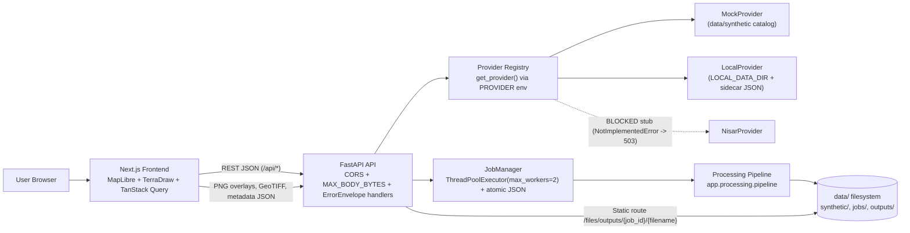
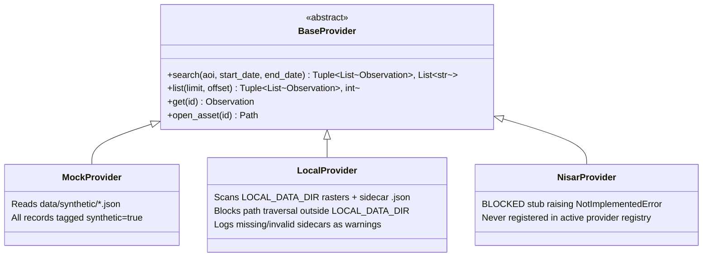
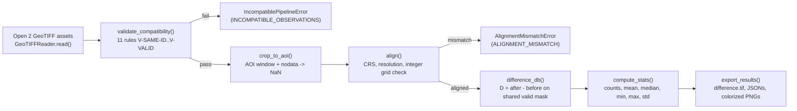
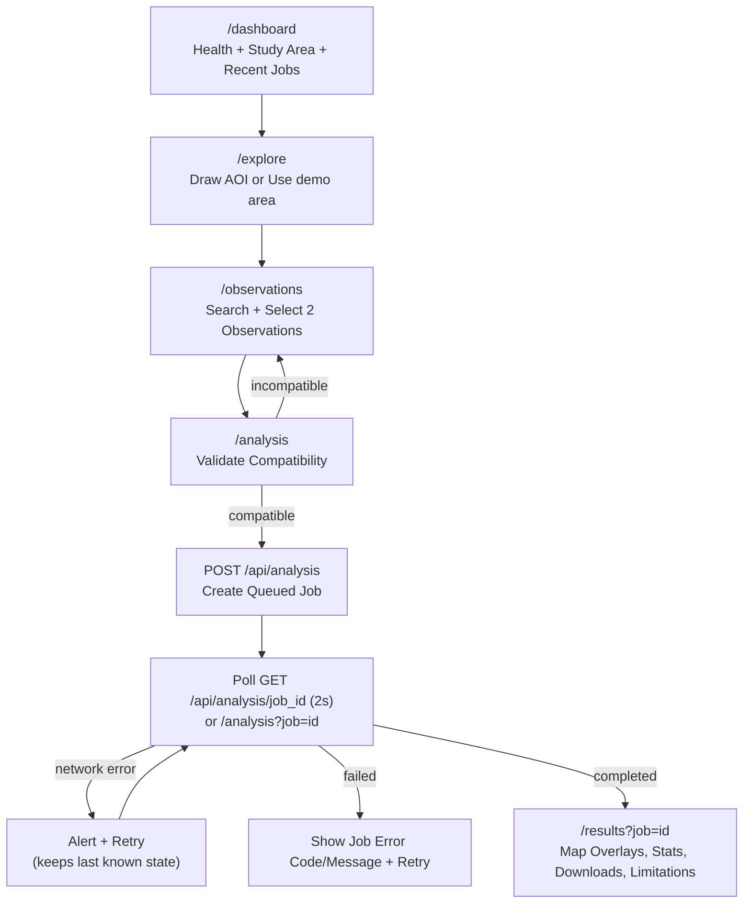
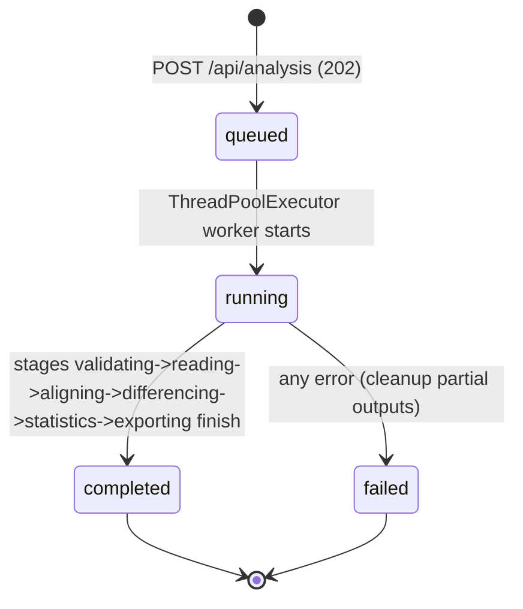

# TerraWatch AI — System Architecture

> Reflects actual implemented Phase A codebase (`backend/app/**`, `frontend/**`, `data/`). No invented NISAR resources or unimplemented microservices are claimed.

## 1. System Overview

TerraWatch AI is a monorepo composed of a **Next.js 14 (App Router, TypeScript)** frontend and a **FastAPI (Python 3.11+)** backend backed by atomic filesystem persistence under `data/`. No external database, message broker, tile server, authentication layer, or AI/LLM service is used.

## 2. Backend Module Layout

- `backend/app/main.py`: FastAPI initialization, CORS middleware (`CORS_ORIGINS`), `enforce_max_body_size` HTTP middleware (`MAX_BODY_BYTES`, default `1_048_576`), global exception handlers (`RequestValidationError`, `StarletteHTTPException`, unhandled `Exception`), and `GET /api/health`.
- `backend/app/config.py`: `Settings` (`pydantic_settings.BaseSettings`) loading environment configuration and validating `PROVIDER` on startup (`validate_provider`).
- `backend/app/schemas/`: Source-of-truth Pydantic models (`common.py`, `observation.py`, `analysis.py`) exported to `backend/openapi.json`.
- `backend/app/providers/`: Provider abstraction and catalog adapters (`base.py`, `registry.py`, `mock_provider.py`, `local_provider.py`, and blocked stub `nisar_provider.py`).
- `backend/app/services/`:
  - `validator.py`: AOI geometry validation (`validate_aoi_geometry` using Shapely + PyProj `Geod` geodesic area against `MAX_AOI_AREA_KM2` and max 500 vertices).
  - `job_manager.py`: In-process `ThreadPoolExecutor(max_workers=2)` worker pool, atomic job JSON writes (`temp` + `os.replace` to `data/jobs/<job_id>.json`), compatibility gate via `app.processing.validation.validate_compatibility`, and output artifact lookup.
- `backend/app/processing/`: Pure geospatial/SAR computation engine (`readers/`, `metadata.py`, `validation.py`, `preprocessing.py`, `alignment.py`, `change_detection.py`, `statistics.py`, `export.py`, `pipeline.py`).

## 3. Provider Architecture

## 4. Raster-Processing Pipeline

## 5. User Workflow & Frontend Architecture

- Five App Router pages under `frontend/app/`:
  - `/dashboard`: API health status (`GET /api/health`), Study Area Summary (from `sessionStorage` AOI), and Recent Analyses hydrated from `localStorage` job IDs via `GET /api/analysis/{job_id}` (preserving 8 endpoints with inline error + Retry).
  - `/explore`: Interactive MapLibre GL + TerraDraw polygon/rectangle AOI selection, `"Use demo area"` action (syncing `custom-aoi-source` and fitting bounds immediately on `style.load`), client-side metrics (`lib/geo.ts`), and map style failure Alert + Retry.
  - `/observations`: Provider search (`POST /api/observations/search`), metadata table (`"Not provided"` fallback), and 2-observation selection with automatic chronological ordering.
  - `/analysis`: Supports both `?before=...&after=...` validation/submission and `?job=<id>` direct job tracking. Polls `GET /api/analysis/{job_id}` every 2s cleanly, pauses on network error with an inline Alert + Retry preserving the last known state, and stops on `completed`/`failed`.
  - `/results`: Fetches `GET /api/analysis/{job_id}/results`, renders `Before` / `After` / `Difference (dB)` layers on MapLibre (scaling power-of-two textures cleanly via canvas data URLs in `ResultsMap.tsx` with style-error Alert + Retry and direct raster fallback), displays legend range from backend `metadata.color_scales.difference`, summary stats, deterministic template summary, and scientific limitations.
- Mobile navigation collapses at `< 768px` (`md`) into a keyboard-operable toggle menu (`Escape` to close) to keep `390px` viewports overflow-free (`scrollWidth === clientWidth`).

## 6. Job Lifecycle & Persistence

Job records are stored atomically as JSON files (`data/jobs/<job_id>.json`) written via temp file + `os.replace`. Pipeline output artifacts live under `data/outputs/<job_id>/` and are cleaned up atomically if any processing stage raises an exception.

